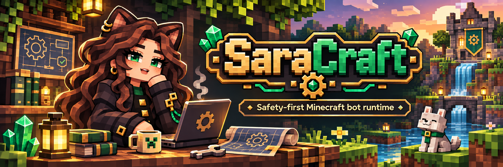

# SaraCraft

A private Minecraft Java AI companion project for cooperative survival.

**Status (2026-11-24): Wave 1 source PRs #5–#11 merged to `main`.** Navigation, observation-control, packaging and attended authentication-only source are reviewed; this does not install, activate, authenticate or permit Minecraft gameplay. The credential-free host acceptance gate passed for source `407a1d8`, while trusted-manifest promotion and real sign-in require separate authorization. See [M0.8 integration](docs/m0-8-integration.md), [source reconciliation](docs/m0-8-reconciliation.md), and [auth packaging/host acceptance](docs/auth-packaging-and-host-acceptance.md).

## Design choices

- New Java survival world, Normal difficulty; candidate protocol 1.21.11 and Java 21.
- Paper on Hephaestus N100, Mineflayer/Mindcraft CE bot and controller there; hosted API initially, local Ollama later.
- Private LAN/WireGuard ingress; online mode, enforced allowlist, distinct licensed accounts, bot not op.
- Model proposes bounded intent; controller independently authorizes it and provides out-of-band STOP.
- World stored on Heph local NVMe, off-host NAS backup with tested restore before acceptance.
- No model-generated code execution, admin access, or trusting in-game names for identity.

## Design documents

- [M0 acceptance](docs/M0-acceptance.md)
- [Compatibility matrix](docs/compatibility-matrix.md)
- [Host and security design](docs/host-and-security-design.md)
- [Controller contract](docs/controller-contract.md)
- [Architecture](docs/architecture.md)
- [Implementation backlog](docs/implementation-backlog.md)

`compose.yaml` is a **nondeployable-by-default design template**. Deployment requires explicit approval, EULA acceptance, verified private bind IP, authenticated allowlist, immutable image digest, and a reviewed build. The illustrative bot profile is not a validated Mindcraft CE schema. No credentials belong in Git.

Next gate: separately authorized trusted-manifest promotion of exact reviewed source `407a1d8`, then separately gated attended authentication and stationary observation. PRs #3 and #4 remain draft. No deployment or gameplay is authorized by source merges.
